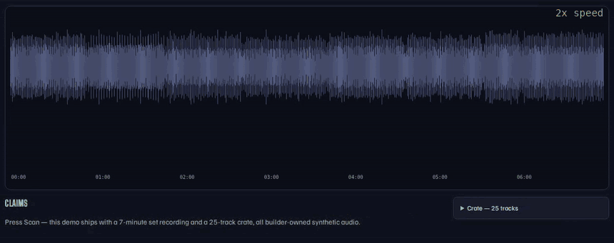

# SetLedger

Clubs pay licensing; the producers a DJ actually played rarely see it. SetLedger turns a set
recording into a timestamped, PRS-ready tracklist matched against the DJ's own crate — and it
never claims a play it can't prove.



**Live demo:** _URL coming at deploy (Oct 17–18)_ · **Demo video:** _link + length at final take_

**Stack, one line:** chromaprint fingerprints decide every claim; CLAP window embeddings in
**Tiger Data** Postgres (pgvector) nominate candidates for unmatched segments; **Gemma** 3 1B
normalizes crate tags under a no-invention guard; deployed on **DigitalOcean** behind a
**.tech** domain.

## How to judge this in 90 seconds

1. Press **Scan Saturday's set** on the live demo (seeded; no sign-in).
2. Watch claims land on the waveform with confidence scores.
3. Click a blue **≈** chip — that play is tempo-shifted +6%, nominated by embeddings and
   confirmed by fingerprints.
4. Note the amber span: no evidence means no claim, it stays flagged for review.
5. Download the royalty pack (PRS-format CSV + PDF).

## What it does

A DJ-producer records their set, points SetLedger at the recording and their crate folder, and
gets back:

- **A claims timeline** — which of *their* tracks played, when, for how long, with a confidence
  score and the method that proved it (`exact ▮` fingerprint run, or `embedding ≈` recall
  confirmed by fingerprints).
- **Review spans** — any stretch with no fingerprint evidence is marked *review — not claimed*.
  The scanner cannot invent a track by construction: candidates only come from the crate, and
  the recall layer must pass the same fingerprint bar as the exact layer.
- **A PRS-format royalty pack** — CSV + PDF with timestamps, durations, confidence, method, and
  a registered/unregistered flag per work.

## Measured results (6 synthetic sets, 48 plays, 25-track crate)

| tier | plays | found (≥50% of the play) | rate |
|---|---|---|---|
| clean plays | 30 | 30 | **100%** |
| tempo-shifted (+6% / −5%) | 12 | 12 | **100%** (via embedding recall) |
| foreign track (not in crate) | 6 | 0 claimed | **0 false claims** |

The demo set plus five more gigs, each generated from a different seed and scanned for real
(~20 s per 7-minute set with CLAP; exact-only mode 2.6 s). The five-gig run is the one that
caught a real bug: on the demo set alone, tempo-shifted looked perfect, but across five gigs it
fell to 4/10 because one shifted play was being reported as two or three fragments
([F-0002](docs/memory/failures/)). Fixed by joining same-track fragments into one play.

Reproduce: `scripts/fetch_corpus.py`, then `scripts/demo_run.py` (demo set) and
`scripts/ledger_demo.py` (five gigs + quarterly statements). Every byte of audio is generated
from seeds, so the numbers are deterministic end to end.

## How it works

1. **Exact layer** — chromaprint raw fingerprints, XOR + popcount at every alignment lag; a
   play is the longest contiguous low bit-error run (not the lowest-error lag: loop-based music
   self-matches at bar offsets, see `docs/memory/failures/F-0001`).
2. **Recall layer** ([Tiger Data](https://www.tigerdata.com/) Postgres + **pgvector**) — CLAP
   audio embeddings of 10 s windows, stored per track; unmatched segments nominate candidate
   tracks by cosine top-k (hybrid tag + vector query). *Embeddings nominate, fingerprints
   confirm*: an atempo sweep (0.90–1.10) must produce a passing fingerprint run before anything
   is claimed, so the vector layer can extend recall but can never create a false claim.
3. **Tag normalization** (**Gemma 3 1B**, local via ollama) — messy crate tags become
   PRS-ready artist/title suggestions under a two-sided vocabulary guard: every output word
   must exist in the raw tag and every content word must survive, so the model may reformat but
   can never invent or lose a name. No model → clean passthrough, flagged in the UI.
   Before/after artifact: [docs/media/tags-before-after.md](docs/media/tags-before-after.md).
4. **The ledger** (**Tiger Data**, TimescaleDB) — every confirmed play from every gig lands in
   a `plays` hypertable partitioned on `played_at`; a `plays_monthly` continuous aggregate
   rolls them up, and the quarterly royalty statement (PRS distributes quarterly) reads the
   pre-rolled buckets instead of rescanning every play ever recorded. Each row carries the
   weakest evidence behind it and whether recall was needed, so a statement line is never
   stronger than its proof. On plain Postgres the same names are a table and a view (that's
   how the tests run without a cloud account); `Ledger.timescale` reports which one is live.
   Example: [docs/media/ledger-statement.md](docs/media/ledger-statement.md).
5. **Web UI** — FastAPI + a single canvas workspace ([UI-SPEC.md](UI-SPEC.md)); deployed on
   **DigitalOcean**, served at a **.tech** domain (links above when live).

## Limits — what this is and isn't

- The demo corpus is **synthetic and builder-owned** (25 procedurally generated tracks; see
  [docs/corpus-licenses.md](docs/corpus-licenses.md)). Real-world audio is harder; the CLAP
  layer exists for exactly that, but the 100% bench numbers are for this corpus, not a claim
  about club recordings at large.
- Tempo robustness is swept over ±10%; harder transforms (key shifts, loops, mashups) land in
  *review*, by design — flagged, never guessed.
- PRS filing itself stays manual: SetLedger produces the evidence pack in the right shape; it
  does not submit to PRS.
- Scan state lives in memory behind one server — a deliberate single-venue scope, not a
  multi-tenant service.

## Run it locally

```bash
sudo apt install ffmpeg libchromaprint-tools     # fpcalc + ffmpeg
python -m venv .venv && .venv/bin/pip install -e ".[dev]"
# optional CLAP recall driver (without it the spectral driver runs, same pipeline):
#   .venv/bin/pip install torch --index-url https://download.pytorch.org/whl/cpu
#   .venv/bin/pip install -e ".[clap]"
.venv/bin/python scripts/fetch_corpus.py        # generate the demo world (deterministic seeds)
.venv/bin/python scripts/demo_run.py            # index -> scan -> bench -> artifacts
.venv/bin/python -m uvicorn setledger.app:app --app-dir src   # the workspace at :8000
```

Postgres/pgvector layer: set `SETLEDGER_PG_DSN` (Tiger Data or `docker-compose up` for local
pgvector), then `pytest tests/test_store_vector.py`.

## Provenance

Built during dev.to Hacktoberfest 2026 Week 2 ("Side Hustle"). The first commit (862a3ad) is
timestamped Tue 13 Oct 16:00 +05:30 (2026-10-13T10:30:54Z), after the build opened at
Tue 13 Oct 00:31 +05:30. Planning (idea research and judging notes) happened before the first
commit and lives outside this repository. Built with Claude Code (Anthropic) driving
implementation, tests and deploys; all architectural decisions and failure records are public
in `.prod-build/` and `docs/memory/`.
